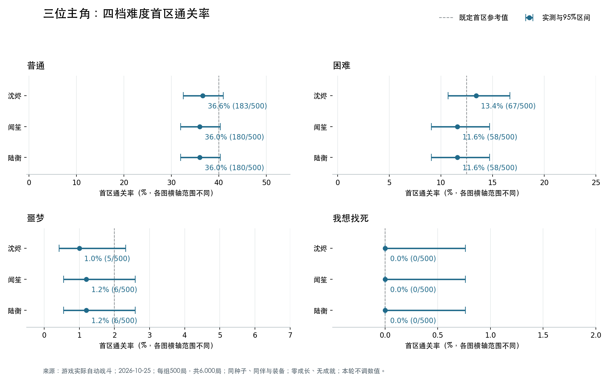

# 三位主角 × 四档难度：首区通关率对照

测试日期：2026 年 10 月 25 日（Asia/Shanghai）。本轮只测试，不修改主角、天赋、技能、敌人或难度数值，也不更新已确认的四档平衡参考值。

## 固定条件

- 每个主角×难度组合 500 局，共 12 个组合、6,000 局，全部重新运行，没有把历史样本计作本轮新跑。
- 每组种子相同：2026102500—2026102999；逐局验证 12 个组合的路线种子一致。
- 唯一主动更换的条件是主角身份：沈烬、闻笙、陆衡。四名同伴始终为阿绫、鸦、白芷、砾，盾卫留守，使用相同七件开局装备分配。
- 三位主角初始面板一致：生命80、法力24、攻击22、防护2、速度12、射程1、经验0，只拥有1级破势。更换主角走实际 select_captain 接口，测试入口不要求解锁；游戏内解锁限制未修改。
- 击败灰潮边境首领并成功撤离算通关。使用实际自动按钮策略，优先战斗、其次补给，只选资源奖励；生命低于70%或法力低于50%时用补给，保留死亡与消耗。
- 不训练、购物、招募、选择遗物或预装成就奖励，沿用已确认基线的零成长策略。
- 全部样本在同一冻结源码快照中运行，检查无无效动作、无战斗步数超限、无运行期源码变更；每位主角另跑5局验证跳过落盘与真实存档模式一致。

## 首区通关率

### 沈烬

- **普通：36.6%（183/500）**；95% Wilson 区间 32.49%—40.91%。[逐局数据](../artifacts/captain-rates-main-shen-0.json)
- **困难：13.4%（67/500）**；95% Wilson 区间 10.69%—16.67%。[逐局数据](../artifacts/captain-rates-main-shen-1.json)
- **噩梦：1.0%（5/500）**；95% Wilson 区间 0.43%—2.32%。[逐局数据](../artifacts/captain-rates-main-shen-2.json)
- **我想找死：0.0%（0/500）**；95% Wilson 区间 0.00%—0.76%。[逐局数据](../artifacts/captain-rates-main-shen-3.json)

### 闻笙

- **普通：36.0%（180/500）**；95% Wilson 区间 31.91%—40.30%。[逐局数据](../artifacts/captain-rates-main-wen-0.json)
- **困难：11.6%（58/500）**；95% Wilson 区间 9.08%—14.70%。[逐局数据](../artifacts/captain-rates-main-wen-1.json)
- **噩梦：1.2%（6/500）**；95% Wilson 区间 0.55%—2.59%。[逐局数据](../artifacts/captain-rates-main-wen-2.json)
- **我想找死：0.0%（0/500）**；95% Wilson 区间 0.00%—0.76%。[逐局数据](../artifacts/captain-rates-main-wen-3.json)

### 陆衡

- **普通：36.0%（180/500）**；95% Wilson 区间 31.91%—40.30%。[逐局数据](../artifacts/captain-rates-main-lu-0.json)
- **困难：11.6%（58/500）**；95% Wilson 区间 9.08%—14.70%。[逐局数据](../artifacts/captain-rates-main-lu-1.json)
- **噩梦：1.2%（6/500）**；95% Wilson 区间 0.55%—2.59%。[逐局数据](../artifacts/captain-rates-main-lu-2.json)
- **我想找死：0.0%（0/500）**；95% Wilson 区间 0.00%—0.76%。[逐局数据](../artifacts/captain-rates-main-lu-3.json)

## 逐种子比较与平衡判断

比较同一难度、同一随机种子下是否通关，用精确 McNemar 双侧检验；对四档×三对主角共12次比较做 Holm 校正，校正后 p<0.05 记为可检出差异。未检出差异不等于证明严格平衡。

12组配对比较经校正后均未检出显著通关率差异；当前固定首区开局下，尚无足够统计证据判定某位主角显著更强。这不是等效性证明，也不覆盖成长后的平衡。

闻笙与陆衡在四档共2,000组同种子对照中，逐场战斗的所有测量字段一致；结合下文两人天赋未触发的记录，应将其理解为此开局条件下表现一致。

### 普通

三位主角最大实测差距为 0.6 个百分点。

- 沈烬对闻笙：差值 +0.6 个百分点；仅前者通关 7 局、仅后者通关 4 局；Holm校正p=1，未检出差异。
- 沈烬对陆衡：差值 +0.6 个百分点；仅前者通关 7 局、仅后者通关 4 局；Holm校正p=1，未检出差异。
- 闻笙对陆衡：差值 +0.0 个百分点；仅前者通关 0 局、仅后者通关 0 局；Holm校正p=1，未检出差异。

### 困难

三位主角最大实测差距为 1.8 个百分点。

- 沈烬对闻笙：差值 +1.8 个百分点；仅前者通关 12 局、仅后者通关 3 局；Holm校正p=0.4219，未检出差异。
- 沈烬对陆衡：差值 +1.8 个百分点；仅前者通关 12 局、仅后者通关 3 局；Holm校正p=0.4219，未检出差异。
- 闻笙对陆衡：差值 +0.0 个百分点；仅前者通关 0 局、仅后者通关 0 局；Holm校正p=1，未检出差异。

### 噩梦

三位主角最大实测差距为 0.2 个百分点。

- 沈烬对闻笙：差值 -0.2 个百分点；仅前者通关 0 局、仅后者通关 1 局；Holm校正p=1，未检出差异。
- 沈烬对陆衡：差值 -0.2 个百分点；仅前者通关 0 局、仅后者通关 1 局；Holm校正p=1，未检出差异。
- 闻笙对陆衡：差值 +0.0 个百分点；仅前者通关 0 局、仅后者通关 0 局；Holm校正p=1，未检出差异。

### 我想找死

三位主角最大实测差距为 0.0 个百分点。

- 沈烬对闻笙：差值 +0.0 个百分点；仅前者通关 0 局、仅后者通关 0 局；Holm校正p=1，未检出差异。
- 沈烬对陆衡：差值 +0.0 个百分点；仅前者通关 0 局、仅后者通关 0 局；Holm校正p=1，未检出差异。
- 闻笙对陆衡：差值 +0.0 个百分点；仅前者通关 0 局、仅后者通关 0 局；Holm校正p=1，未检出差异。

本档三人均为零胜，存在地板效应，不能据此可靠排出主角强弱；0/500的95% Wilson上限约0.76%，不代表真实概率绝对为零。

## 天赋是否被实际用到

- **沈烬**：四档共2,000局中，1964局记录到自身天赋触发，合计8311次；沈烬号令后续命中事件3879次。
- **闻笙**：四档共2,000局中，0局记录到自身天赋触发，合计0次；沈烬号令后续命中事件0次。
- **陆衡**：四档共2,000局中，0局记录到自身天赋触发，合计0次；沈烬号令后续命中事件0次。

沈烬可用初始破势触发号令；闻笙需要振奋或军心回响恢复同伴，陆衡需要同次行动施放两个来源职业不同的主动技能。本测试三人都只有1级破势，不能触发后两位的天赋；必须结合实测触发数解读。

此结论针对首区零成长开局，不代表训练后、跨职业技能组合或专属遗物成型后的整体平衡。即便闻笙和陆衡数据一致，也不代表两人的完整培养路线相同；同样不能仅凭沈烬触发次数较多就推定其所有培养阶段必然更强。

## 失败阶段

- 沈烬／普通：普通遭遇失败1局、精英失败109局、首领失败207局；到达首领390局。
- 沈烬／困难：普通遭遇失败19局、精英失败229局、首领失败185局；到达首领252局。
- 沈烬／噩梦：普通遭遇失败110局、精英失败253局、首领失败132局；到达首领137局。
- 沈烬／我想找死：普通遭遇失败462局、精英失败29局、首领失败9局；到达首领9局。
- 闻笙／普通：普通遭遇失败1局、精英失败108局、首领失败211局；到达首领391局。
- 闻笙／困难：普通遭遇失败17局、精英失败237局、首领失败188局；到达首领246局。
- 闻笙／噩梦：普通遭遇失败116局、精英失败253局、首领失败125局；到达首领131局。
- 闻笙／我想找死：普通遭遇失败461局、精英失败30局、首领失败9局；到达首领9局。
- 陆衡／普通：普通遭遇失败1局、精英失败108局、首领失败211局；到达首领391局。
- 陆衡／困难：普通遭遇失败17局、精英失败237局、首领失败188局；到达首领246局。
- 陆衡／噩梦：普通遭遇失败116局、精英失败253局、首领失败125局；到达首领131局。
- 陆衡／我想找死：普通遭遇失败461局、精英失败30局、首领失败9局；到达首领9局。

## 与既有基线及版本的关系

既有的40%、12.5%、2%、0%是已确认的沈烬首区参考值，不要求每位主角或每次小样本精确命中。本轮每组500局，历史每档1,000局，不能将两个不同样本量的百分比差异直接当成数值回归。

- 沈烬／普通：与历史同一组前500局的逐局、逐战公共字段完全一致。
- 沈烬／困难：与历史同一组前500局的逐局、逐战公共字段完全一致。
- 沈烬／噩梦：与历史同一组前500局的逐局、逐战公共字段完全一致。
- 沈烬／我想找死：与历史同一组前500局的逐局、逐战公共字段完全一致。

运行结束时工作区与冻结快照存在以下差异。本轮精确通关率对应归档的冻结源码，不混合版本。

- `campaign.gd`：战斗经验池提高与首件遗物商店优惠；本策略不训练、不购物，经验不自动提升面板或技能等级；快照 4c9089112110，当前 8f1fc8678ddc。
- `main.gd`：游戏界面改动；模拟不加载主场景或界面脚本；快照 4ee20a3ed272，当前 cf9bba48e926。
- `relics.gd`：奖励向已持有的第二主题倾斜；本策略不选择或携带遗物，主题计数始终为空，新增筛选不改变候选主题或随机抽取；快照 ca05691b5ec9，当前 ef214523016a。

另在当前工作区对12个组合各重跑前5局，共60局逐局逐战字段与冻结快照完全一致。以上差异不作用于本次固定策略，但不能据此推断它们对正常培养、购物或遗物玩法没有影响。

## 复现资料

- [结构化汇总、逐种子比较与天赋计数](../artifacts/captain-rates-summary-2026-10-25.json)。
- [冻结源码与验证记录](../artifacts/captain-rates-source-2026-10-25.zip)。
- 逐局报告共12份，命名为 `artifacts/captain-rates-main-{shen|wen|lu}-{0|1|2|3}.json`。
- 运行器：`tools/simulate_captain_rates.gd`；汇总：`tools/summarize_captain_rates.py`。
- [已确认的四档难度平衡基线](difficulty-balance-baseline-2026-10-25.md)。
