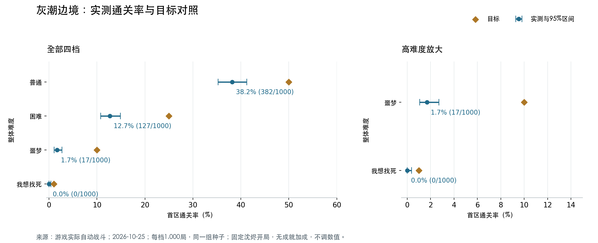

# 四档难度首区通关率实测

测试日期：2026 年 10 月 25 日（Asia/Shanghai）。本轮只测量，不修改游戏难度或战斗数值。

**测试后的确认：保留现有四档数值，后续首区平衡参考采用普通 40%、困难 12.5%、噩梦 2%、我想找死 0%。** 精确实测仍为 38.2%、12.7%、1.7%、0/1,000；0% 是零胜样本的参考值，不代表真实概率绝对为零。以下 50%、25%、10%、1% 的对照、差值、图表及“偏高”判断保留为测试时的历史分析，不再作为当前调参要求。后续评估以[已确认的四档难度平衡基线](difficulty-balance-baseline-2026-10-25.md)为准，原始数据不改写。

## 口径与固定条件

- 一局从零开始；击败灰潮边境首领并成功撤离，才记为通关。不是通关全部六个区域。
- 每档 1,000 局，共 4,000 局；四档使用完全相同的种子 2026102500—2026103499，并验证每局路线种子一致。
- 固定沈烬、阿绫、鸦、白芷、砾五人；按既有普通 50% 校准策略分配七件开局装备，板甲不穿。死亡与血蓝消耗保留，不复活、不重试。
- 优先战斗，其次免费补给；只选资源奖励；任意存活队员生命不足 70% 或法力不足 50% 时使用补给。
- 战斗使用游戏实际的 Rules.auto_action 自动按钮策略；不额外训练、购物、招募或选择遗物，不预装成就奖励。
- 在隔离源码快照中运行；每 100 局为一批，各批源码与策略哈希一致，并在汇总时与当前项目源码再次核对；版本差异见下文。
- 内存运行仅跳过存档落盘与成就文件读取，战斗、路线、奖励、补给、死亡和撤离调用实际游戏接口；额外 10 局与真实落盘模式逐局比较，结果、每场战斗、剩余生命、补给和路线种子完全一致；同一批结果也与原始普通难度模拟器逐战一致。

## 精确实测结果与历史目标对照

- **普通**：382/1,000，**38.2%**；目标 50%；差值 -11.8 个百分点；95% Wilson 区间 35.24%—41.25%；低于目标。
- **困难**：127/1,000，**12.7%**；目标 25%；差值 -12.3 个百分点；95% Wilson 区间 10.78%—14.91%；低于目标。
- **噩梦**：17/1,000，**1.7%**；目标 10%；差值 -8.3 个百分点；95% Wilson 区间 1.06%—2.71%；低于目标。
- **我想找死**：0/1,000，**0.0%**；目标 1%；差值 -1.0 个百分点；95% Wilson 区间 0.00%—0.38%；低于目标。



## 失败集中在哪里

- **普通**：普通遭遇失败 4 局、精英失败 209 局、首领失败 405 局；到达首领 787 局，其中击败首领 382 局；首次战斗即失败 2 局。
- **困难**：普通遭遇失败 33 局、精英失败 452 局、首领失败 388 局；到达首领 515 局，其中击败首领 127 局；首次战斗即失败 12 局。
- **噩梦**：普通遭遇失败 220 局、精英失败 490 局、首领失败 273 局；到达首领 290 局，其中击败首领 17 局；首次战斗即失败 70 局。
- **我想找死**：普通遭遇失败 898 局、精英失败 71 局、首领失败 31 局；到达首领 31 局，其中击败首领 0 局；首次战斗即失败 296 局。

## 测试时的梯度判断（相对历史目标）

四档实测通关率严格递减，变难方向成立。

四档目标均高于各自的 95% Wilson 区间，当前固定策略下的整体难度偏高。

困难→噩梦：目标希望保留 40% 的通关率（10%/25%）；实测只保留 13.4%，这一档的下降明显更陡。

最高难度在 1,000 局中没有通关，95% Wilson 上限为 0.38%，低于 1% 目标；这不表示真实通关率绝对为零。

本轮没有据此调整任何游戏数值。

## 版本检查

运行期间，工作区另有以下改动；本轮 4,000 局全部来自同一冻结快照，没有混合版本，也没有在本轮改动这些文件。

- `enemy_ai.gd`：仅修改暮雾沼泽的团长优先级；灰潮边境的优先级不变。
- `enemy_skills.gd`：仅给遗城汲能技能补充护盾全挡时耗蓝逻辑和说明；边境敌人不使用汲能技能，其他效果的零伤害分支保持原语义。
- `regions.gd`：仅修改星陨遗城的说明文案，边境定义与机制不变。
- `relic_expansion.gd`：仅调整血契与守誓遗物共鸣，本策略不选择或携带遗物，奖励抽取使用的家族键与物品池不变。

代码差异复核显示，上述改动不作用于本次“灰潮边境、无遗物”的测试条件；另外在当前工作区对每档前 10 局重跑，共 40 局逐局逐战数据与冻结快照完全一致。完整抽样率仍对应归档的冻结源码。


## 解读范围

这些结果衡量当前版本、固定开局与固定自动策略的首区通关概率，不等同于所有真人玩家、主角、遗物构筑和养成策略的概率。高难度实际解锁后的成就属性、后续技能训练与购物可能改变结果；本次为了单独比较敌人强度，没有混入这些收益。

区间反映有限种子样本的不确定性。0/1,000 只表示本次没有观察到通关，不表示真实概率绝对为零。目标落在区间外时，本样本不支持该目标已经达成；“接近目标”也不是证明真实概率恰好等于目标。

固定种子下，更高难度偶尔通关而低难度失败并不自动意味着数值倒挂：敌人生命变化可能改变自动策略的目标选择和行动顺序。梯度评价以整体通关率为主。

## 可复现资料

- 汇总与失败分布：`artifacts/difficulty-rates-summary-2026-10-25.json`。
- 全部逐局、逐战数据：`artifacts/difficulty-rates-main-0.json` 至 `artifacts/difficulty-rates-main-3.json`。
- 运行源码与策略快照：`artifacts/difficulty-rates-source-2026-10-25.zip`。
- 模拟：`tools/simulate_difficulty_rates.gd`；汇总：`tools/summarize_difficulty_rates.py`。

单档重跑示例（需先建好 artifacts 目录；精确复现应使用归档源码，当前源码另有变更时应建立新的验证记录）：

```sh
.tools/Godot.app/Contents/MacOS/Godot --headless --path . --script res://tools/simulate_difficulty_rates.gd -- --difficulty=0 --count=1000 --label=main
```

四档的 `--difficulty` 分别为 0、1、2、3。默认种子从 2026102500 起；支持 `--count` 和 `--seed-start` 分批运行。汇总校验要求每档恰好 1,000 局且种子完整不重复。
