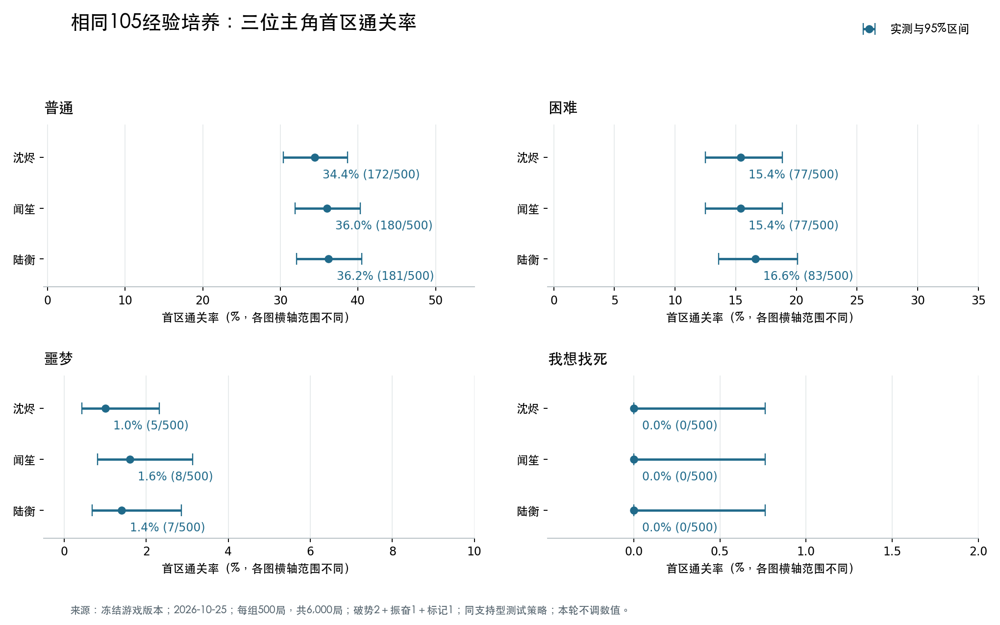

# 相同105经验培养后三位主角的首区平衡测试

测试日期：2026 年 10 月 25 日（Asia/Shanghai）。只在测试队伍中注入经验并学习技能，没有调整游戏数值、主角天赋、技能成本、敌人或游戏内自动战斗。原有四档平衡基线不变。

## 相同预算、相同技能包

三位主角每局都获得105点测试经验，通过真实 `Campaign.train_skill` 接口逐项扣费，实际花费均为105，初始剩余经验均为0。没有修改技能等级字段绕过费用或前置条件。

- 破势：原有1级升至2级，45经验。
- 振奋：学习1级，30经验；前置破势2级已满足。
- 猎物标记：跨职业学习1级，30经验；主角按现行规则可学习。

三人拥有完全相同的技能和面板，主动变化仅为主角身份。沈烬可用破势触发号令；闻笙可用振奋恢复同伴并触发护盾；陆衡可在4行动点内使用猎物标记（1点）＋破势（3点），支付真实法力后触发跨职业回蓝。

四位同伴始终为阿绫、鸦、白芷、砾，保持原始技能与经验，盾卫留守。装备沿用既有七件分配，没有额外武器、饰品、遗物或成就加成。后续战斗虽正常获得经验，但本测试不再训练，不将战后额外经验加入105预算。

## 共享测试策略与口径

- 每个主角×难度组合500局，共12组、6,000局，种子2026102500—2026102999逐局配对，验证12组路线种子一致。
- 从零开始，击败灰潮边境首领并成功撤离才算通关；死亡与血蓝消耗保留，不复活、不重试。
- 路线优先战斗，其次补给；只选资源奖励；生命低于70%或法力低于50%时用补给。不购物、不招募、不选择遗物。
- 开测版本的游戏自动按钮只主动挑选伤害技能，不主动治疗或标记；直接沿用会让后两位天赋仍难以进入测试。
- 本轮统一使用项目已有的 `relic_mix_simulation.step` 支持型模拟策略：按公开战况避开首领预告、治疗受伤队友、在合适行动预算下标记、再选择伤害及移动。所有主角与同伴共用同一规则，不按主角身份安排专属脚本，也不修改游戏内自动策略。
- 因为策略与培养预算都不同，本轮结果不能与上次零成长、自动按钮策略的百分比直接相减来衡量培养收益，也不替代40%/12.5%/2%/0%的原基线。
- 在同一冻结源码中运行，预算及天赋探针24项通过；三位主角各10局与真实存档落盘模式完全一致。

## 首区通关率

### 沈烬

- **普通：34.4%（172/500）**；95% Wilson区间 30.37%—38.67%。[逐局数据](../artifacts/trained-captain-rates-main-shen-0.json)
- **困难：15.4%（77/500）**；95% Wilson区间 12.50%—18.83%。[逐局数据](../artifacts/trained-captain-rates-main-shen-1.json)
- **噩梦：1.0%（5/500）**；95% Wilson区间 0.43%—2.32%。[逐局数据](../artifacts/trained-captain-rates-main-shen-2.json)
- **我想找死：0.0%（0/500）**；95% Wilson区间 0.00%—0.76%。[逐局数据](../artifacts/trained-captain-rates-main-shen-3.json)

### 闻笙

- **普通：36.0%（180/500）**；95% Wilson区间 31.91%—40.30%。[逐局数据](../artifacts/trained-captain-rates-main-wen-0.json)
- **困难：15.4%（77/500）**；95% Wilson区间 12.50%—18.83%。[逐局数据](../artifacts/trained-captain-rates-main-wen-1.json)
- **噩梦：1.6%（8/500）**；95% Wilson区间 0.81%—3.13%。[逐局数据](../artifacts/trained-captain-rates-main-wen-2.json)
- **我想找死：0.0%（0/500）**；95% Wilson区间 0.00%—0.76%。[逐局数据](../artifacts/trained-captain-rates-main-wen-3.json)

### 陆衡

- **普通：36.2%（181/500）**；95% Wilson区间 32.11%—40.50%。[逐局数据](../artifacts/trained-captain-rates-main-lu-0.json)
- **困难：16.6%（83/500）**；95% Wilson区间 13.60%—20.11%。[逐局数据](../artifacts/trained-captain-rates-main-lu-1.json)
- **噩梦：1.4%（7/500）**；95% Wilson区间 0.68%—2.86%。[逐局数据](../artifacts/trained-captain-rates-main-lu-2.json)
- **我想找死：0.0%（0/500）**；95% Wilson区间 0.00%—0.76%。[逐局数据](../artifacts/trained-captain-rates-main-lu-3.json)

## 配对差异与平衡判断

同一难度内对同一种子的通关结果进行精确McNemar双侧检验，12组比较统一作Holm校正，校正后p<0.05记为可检出差异。未检出差异不等于证明严格等效。

本轮12组配对在校正后均未检出显著差异；当前105经验共同技能包下，尚无足够统计证据认定某位主角显著更强，也不构成所有培养阶段平衡的证明。

### 普通

最大实测差距：1.8个百分点。

- 沈烬对闻笙：-1.6个百分点；仅前者通关7局，仅后者通关15局；校正p=1，未检出差异。
- 沈烬对陆衡：-1.8个百分点；仅前者通关3局，仅后者通关12局；校正p=0.4219，未检出差异。
- 闻笙对陆衡：-0.2个百分点；仅前者通关16局，仅后者通关17局；校正p=1，未检出差异。

### 困难

最大实测差距：1.2个百分点。

- 沈烬对闻笙：+0.0个百分点；仅前者通关3局，仅后者通关3局；校正p=1，未检出差异。
- 沈烬对陆衡：-1.2个百分点；仅前者通关1局，仅后者通关7局；校正p=0.7734，未检出差异。
- 闻笙对陆衡：-1.2个百分点；仅前者通关3局，仅后者通关9局；校正p=1，未检出差异。

### 噩梦

最大实测差距：0.6个百分点。

- 沈烬对闻笙：-0.6个百分点；仅前者通关2局，仅后者通关5局；校正p=1，未检出差异。
- 沈烬对陆衡：-0.4个百分点；仅前者通关1局，仅后者通关3局；校正p=1，未检出差异。
- 闻笙对陆衡：+0.2个百分点；仅前者通关3局，仅后者通关2局；校正p=1，未检出差异。

### 我想找死

最大实测差距：0.0个百分点。

- 沈烬对闻笙：+0.0个百分点；仅前者通关0局，仅后者通关0局；校正p=1，未检出差异。
- 沈烬对陆衡：+0.0个百分点；仅前者通关0局，仅后者通关0局；校正p=1，未检出差异。
- 闻笙对陆衡：+0.0个百分点；仅前者通关0局，仅后者通关0局；校正p=1，未检出差异。

三人均零通关，存在地板效应，不能据此排出高难度强弱。0/500的95% Wilson上限约0.76%，不是绝对不可能通关。

## 天赋实际触发

- 沈烬／普通：446/500局出现自身天赋事件，合计797次。
- 沈烬／困难：400/500局出现自身天赋事件，合计652次。
- 沈烬／噩梦：388/500局出现自身天赋事件，合计580次。
- 沈烬／我想找死：321/500局出现自身天赋事件，合计442次。
- 闻笙／普通：391/500局出现自身天赋事件，合计728次。
- 闻笙／困难：364/500局出现自身天赋事件，合计667次。
- 闻笙／噩梦：325/500局出现自身天赋事件，合计549次。
- 闻笙／我想找死：225/500局出现自身天赋事件，合计323次。
- 陆衡／普通：345/500局出现自身天赋事件，合计483次。
- 陆衡／困难：315/500局出现自身天赋事件，合计443次。
- 陆衡／噩梦：331/500局出现自身天赋事件，合计440次。
- 陆衡／我想找死：295/500局出现自身天赋事件，合计405次。

记录的是实际战斗日志中的天赋事件，不是仅凭已学技能推断；触发次数也不等于对胜率的直接贡献。沈烬的号令宣告与后续命中另有独立计数，避免把对已阵亡目标的宣告全部视为有效增伤。

## 失败阶段与首领到达率

- 沈烬／普通：普通遭遇失败1局、精英失败118局、首领失败209局；到达首领381/500局。
- 沈烬／困难：普通遭遇失败19局、精英失败233局、首领失败171局；到达首领248/500局。
- 沈烬／噩梦：普通遭遇失败110局、精英失败250局、首领失败135局；到达首领140/500局。
- 沈烬／我想找死：普通遭遇失败432局、精英失败44局、首领失败24局；到达首领24/500局。
- 闻笙／普通：普通遭遇失败1局、精英失败109局、首领失败210局；到达首领390/500局。
- 闻笙／困难：普通遭遇失败20局、精英失败229局、首领失败174局；到达首领251/500局。
- 闻笙／噩梦：普通遭遇失败110局、精英失败251局、首领失败131局；到达首领139/500局。
- 闻笙／我想找死：普通遭遇失败425局、精英失败50局、首领失败25局；到达首领25/500局。
- 陆衡／普通：普通遭遇失败1局、精英失败122局、首领失败196局；到达首领377/500局。
- 陆衡／困难：普通遭遇失败18局、精英失败233局、首领失败166局；到达首领249/500局。
- 陆衡／噩梦：普通遭遇失败108局、精英失败252局、首领失败133局；到达首领140/500局。
- 陆衡／我想找死：普通遭遇失败431局、精英失败46局、首领失败23局；到达首领23/500局。

## 结论范围与源码

这是一套相同预算、相同技能包、相同策略的天赋对照，不是搜索每个主角的最优流派。它覆盖天赋开始进入实战的105经验阶段，不覆盖更高预算、多职业连招、遗物成型、其他队伍或真人手动操作。

全部6,000局无无效动作、无步数超限，训练扣费与前置条件逐局核验。精确结果对应归档的冻结源码。

原实验运行结束时工作区与冻结源码有差异：`rules.gd`。各组结果没有混合版本。

差异复核：工作区为自动按钮新增了治疗与医者走位判断；本次共享模拟策略不调用这些新增的自动决策函数，使用的 auto_best_hit 与实际结算方法未在该差异中改变。

原实验另在当时工作区对12个组合各复跑前5局，共60局，逐局逐战字段及训练账本与冻结快照完全一致。完整6,000局仍以归档的冻结源码为准。

模拟辅助库 relic_mix_simulation.gd 另有新增的 support_ai 开关及保护分支，默认值为 false。本驱动从未开启该开关，新增分支不进入本次执行路径；当前库的12组、共60局复核结果与冻结数据完全一致。冻结库与当前库分别归档，原始策略哈希没有改写。

## 资料

- [结构化汇总、训练账本与配对比较](../artifacts/trained-captain-rates-summary-2026-10-25.json)。
- [冻结源码、测试探针与真实存档验证](../artifacts/trained-captain-rates-source-2026-10-25.zip)。
- [上一次零成长对照](captain-balance-report-2026-10-25.md)与[已确认难度基线](difficulty-balance-baseline-2026-10-25.md)。
- 运行器：`tools/simulate_trained_captains.gd`；预算方案：`tools/captain_training_plan.gd`；汇总：`tools/summarize_trained_captains.py`。

## 合并前复核 · 2026-10-25

本次审计全部6,000局的原始记录、训练账本、配对统计及冻结源码，汇总结果与归档一致。再以本次提交的当前游戏代码，对12个主角与难度组合各复跑前5局，共60局；逐局逐战结果与原始记录完全一致。24项培养预算及天赋回归现已接入完整验证入口。原6,000局及历史复核文件保持原样，本次没有把60局复跑冒充全量重测。见[本次交付复核](../artifacts/trained-captain-delivery-verification-2026-10-25.json)。
